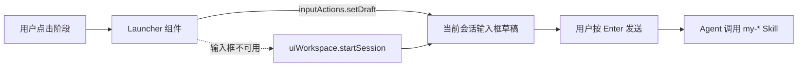

# 999 SDD 阶段启动器 — 技术方案

| 项 | 值 |
|---|---|
| Feature | 999-sdd-stage-launcher |
| 关联 | [PRD](../spec/PRD.md) · [方案评审](../review/design_review.md) |
| 实现位置 | `plugins/my-sdd-launcher/`（独立 bundle，安装到当前 DSH profile） |

## 1. 结论

用一个 **Client-only bundle** 实现：`conversation.composer.dock` 槽位注册一个 React 组件，点击阶段时调用槽位标准入参 `inputActions.setDraft(prompt)` 写入当前输入框；`uiWorkspace.startSession` 仅作回退。Host 半边是空 `apply()`，只为让 Loader 有一条可管理的插件记录。

不新增 Host 服务，不读写文件，不引入构建链路，因此插件可以在不改动 `packages/` 的前提下随仓库一起提交并通过 `plugin_manager install_bundle` 安装。

## 2. 结构

```
plugins/my-sdd-launcher/
├── package.json        # 名称、exports、dsh.bundle / dsh.client 声明
├── cordis.patch.yml    # insert 一条插件行
├── index.js            # Host 半边：export function apply() {}
├── client.js           # 浏览器半边：__ModuleLoader__ 工厂 + 槽位注册
├── locale/{zh,en}.json # meta.title / meta.description
└── icon.svg            # 原创图标
```

`package.json` 关键字段：

- `dsh.bundle.patch` 指向 `cordis.patch.yml`，使包成为 bundle。
- `dsh.client` 声明 `platform: web`、`immediately: true` 与信息性 `inject` 包名（conversation / workspace 两个 UI 包）。
- `exports` 暴露 `.`、`./client`、`./locale/*.json`、`./icon`，`files` 覆盖全部运行时文件。

## 3. 扩展点与数据流



- 槽位：`conversation.composer.dock`（list，session 作用域），作用域内组件自带标准入参 `inputActions`、`useSession` 等，无需自行获取会话对象。
- 注册：`ctx.slots.inject('conversation.composer.dock', () => ctx.slots.register({ name, id, order }, Launcher))`。`inject` 等待槽位声明就绪，槽位被撤销时贡献一并移除。
- 依赖：Cordis `inject: ['slots', 'uiWorkspace']`；`uiWorkspace` 只在回退路径使用。
- 提示词：8 条常量模板，形如 `使用 my-create-prd 为当前 Feature 编写或更新 PRD。`，与 `mai-specs` 约定的阶段 Skill 一一对应。

## 4. 失败处理

| 场景 | 处理 |
|---|---|
| `inputActions.setDraft` 抛错 | 捕获后在栏内以 `role="alert"` 显示 `无法启动阶段：<message>`，不改变会话状态。 |
| 槽位未提供 `inputActions`（旧版前端或无会话） | 回退 `uiWorkspace.startSession(undefined, { prompt })`，成功后提示「已新建会话」。 |
| 回退也抛错 | 同上，显示错误文案，不静默吞掉。 |
| 插件未安装/未激活 | 槽位不存在或占用列表无 `my-sdd-launcher`，属于可观测的安装问题，由安装结果判断。 |

不写全局变量，不监听 DOM，不缓存跨会话状态；状态只存在于组件 `useState`。

## 5. 实现任务

1. 建 bundle 骨架：`package.json`、`cordis.patch.yml`、空 Host `index.js`、`locale` 与 `icon`。
2. 实现 `client.js`：阶段常量、Launcher 组件、成功/失败状态、槽位注册与回退。
3. 安装到 profile（`plugin_manager install_bundle`），确认 `application: applied`。
4. 用 `Slots.listSubTree(root=conversation.composer.dock)` 确认占用项 `my-sdd-launcher` 处于 active。
5. 人工验证：点击阶段 → 输入框出现提示词 → 发送后 Agent 进入对应阶段。
6. 记录验收证据到 `test/ACCEPTANCE.md` 与 `test/EVIDENCE.json`。

## 6. 取舍与风险

- **不做 mai-specs 解析**：Client 侧没有直接的宿主机文件读取契约；用 `uiWorkspace.listDirectory` 会引入路径与权限处理，且与「一键填入提示词」的核心价值无关。留作后续 Feature。
- **不做自动发送**：发送属于用户授权动作（PRD 的 US3），插件只填充草稿，避免误发。
- **样式用内联 CSS 变量**：bundle 不经过仓库 CSS Modules 构建，内联样式可随组件卸载释放，且继承 `--dsw-*` 主题变量。
- **风险：DSH 客户端扩展点演进**。`inputActions.setDraft` 属于槽位标准入参；若后续改名，插件会回退到 `startSession` 并提示，需在升级时跟进。
- **风险：槽位顺序变化**。`order: 20` 仅决定同槽位内相对位置，不影响其他插件。
